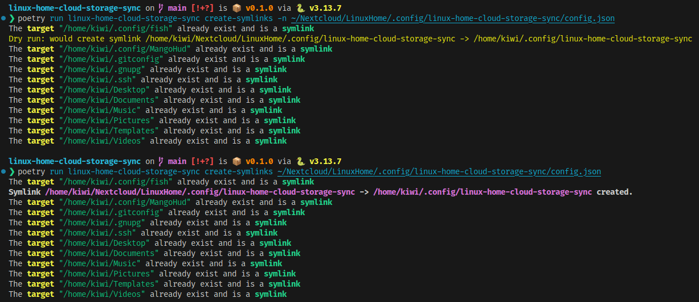

<!-- omit from toc -->
# linux‑home‑cloud‑storage‑sync

*A tiny CLI to keep a “cloud‑storage‑home” folder in sync with the rest of your Linux home.*

> ⚡️ **What it does** – It creates (or deletes) symlinks inside your `$HOME` that point to a
> folder in your cloud storage (e.g. Nextcloud, Dropbox, …).  
> You just give it a config file and the tool takes care of the rest.

<!-- [](https://pypi.org/project/linux-home-cloud-storage-sync/)
[](https://pypi.org/project/linux-home-cloud-storage-sync/) -->
[](#installation)
<!-- [](#license) -->

<!-- omit from toc -->
## Table of Contents

- [Features](#features)
- [How it works](#how-it-works)
- [Installation](#installation)
- [Quick start](#quick-start)
- [Usage](#usage)
  - [Dry Run Example](#dry-run-example)
  - [Actual Run Example](#actual-run-example)
  - [Rich Output Example](#rich-output-example)
- [TODOs \& Roadmap](#todos--roadmap)


---

## Features

| Feature                            | Status |
| ---------------------------------- | ------ |
| Dry‑run mode (`-n` / `--dry-run`)  | ✅      |
| Create symlinks                    | ✅      |
| Delete symlinks                    | ⚙️      |
| Force recreation of existing links | ⚙️      |
| Verbose output & colourised log    | ⚙️      |
| Unit tests (WIP)                   | ⚙️      |

---

## How it works

The tool **only creates symlinks** – it never moves or copies your data. For every entry
in `symlinkMap` it looks at two paths:

- **source** – `cloudStorageHomeDir/<entry>` (the copy living in your cloud storage)
- **target** – `localHomeDir/<entry>` (the location in your `$HOME`)

and then applies this rule:

| Situation                            | Action                                             |
| ------------------------------------ | -------------------------------------------------- |
| source exists **and** target missing | create symlink `target → source`                   |
| source does **not** exist            | do nothing (just print a notice)                   |
| target already exists                | do nothing (just print a notice)                   |

So the direction is **cloud → home**: the authoritative copy must already live inside
`cloudStorageHomeDir`. The tool will **not** migrate an existing file for you, and it will
**not** overwrite anything that is already present in your `$HOME`.

### First‑time migration

Because the tool leaves existing files untouched, adding a *new* entry to `symlinkMap`
takes one manual step first – move the real file/folder into your cloud storage, keeping
the same relative path:

```fish
# Example: back up ~/.claude/skills
mkdir -p ~/Nextcloud/LinuxHome/.claude
mv ~/.claude/skills ~/Nextcloud/LinuxHome/.claude/

# then let the tool link it back into $HOME
linux-home-cloud-storage-sync create-symlinks -n   # dry-run first
linux-home-cloud-storage-sync create-symlinks
```

After that the file lives in the cloud and `~/.claude/skills` is a symlink pointing to it.

---

## Installation

The package is managed with **Poetry** – it’s the same tool that builds, tests, and publishes the wheel.

> ⚙️ You can install locally in a virtual‑env.

```fish
# 1. Create a virtual‑env (recommended)
python -m venv .venv

# 2. Tell Poetry to use that interpreter
poetry env use .venv/bin/python

# 3. Install the package *and* its dependencies
poetry install

# 4. (Optional) Activate the shell integration
poetry env activate

# 5. (Optional) Run your IDE
code ./
```

---

## Quick start

1. Create a config file (JSON, see below for the schema) inside the folder you keep in your cloud storage (e.g. `~/Nextcloud/LinuxHome/.config/linux-home-cloud-storage-sync/config.json`). Or run the CLI to create one from a template.
   
   ```fish
   poetry run linux-home-cloud-storage-sync write-default-config
   ```
2. Run the CLI pointing to that config file.

   ```fish
   poetry run linux-home-cloud-storage-sync create-symlinks
   ```

---

## Usage

```fish
❯ poetry run linux-home-cloud-storage-sync --help
                                                                                                                     
 Usage: linux-home-cloud-storage-sync [OPTIONS] COMMAND [ARGS]...                                                    
                                                                                                                     
╭─ Options ─────────────────────────────────────────────────────────────────────────────────────────────────────────╮
│ --version                       Show program version and exit.                                                    │
│ --install-completion            Install completion for the current shell.                                         │
│ --show-completion               Show completion for the current shell, to copy it or customize the installation.  │
│ --help                -h        Show this message and exit.                                                       │
╰───────────────────────────────────────────────────────────────────────────────────────────────────────────────────╯
╭─ Commands ────────────────────────────────────────────────────────────────────────────────────────────────────────╮
│ print-template-config   Prints the template configuration                                                         │
│ write-default-config    Writes the template                                                                       │
│ create-symlinks         Creates symlinks from CloudStorage/LinuxHome to $HOME                                     │
╰───────────────────────────────────────────────────────────────────────────────────────────────────────────────────╯
```

### Dry Run Example

```fish
linux-home-cloud-storage-sync on  main [!+?] is 📦 v0.1.0 via 🐍 v3.13.7 
❯ poetry run linux-home-cloud-storage-sync create-symlinks -n ~/Nextcloud/LinuxHome/.config/linux-home-cloud-storage-sync/config.json 
The target "/home/kiwi/.config/fish" already exist and is a symlink
Dry run: would create symlink /home/kiwi/Nextcloud/LinuxHome/.config/linux-home-cloud-storage-sync -> /home/kiwi/.config/linux-home-cloud-storage-sync
The target "/home/kiwi/.config/MangoHud" already exist and is a symlink
The target "/home/kiwi/.gitconfig" already exist and is a symlink
The target "/home/kiwi/.gnupg" already exist and is a symlink
The target "/home/kiwi/.ssh" already exist and is a symlink
The target "/home/kiwi/Desktop" already exist and is a symlink
The target "/home/kiwi/Documents" already exist and is a symlink
The target "/home/kiwi/Music" already exist and is a symlink
The target "/home/kiwi/Pictures" already exist and is a symlink
The target "/home/kiwi/Templates" already exist and is a symlink
The target "/home/kiwi/Videos" already exist and is a symlink
```

### Actual Run Example

```fish
linux-home-cloud-storage-sync on  main [!+?] is 📦 v0.1.0 via 🐍 v3.13.7 
❯ poetry run linux-home-cloud-storage-sync create-symlinks ~/Nextcloud/LinuxHome/.config/linux-home-cloud-storage-sync/config.json
The target "/home/kiwi/.config/fish" already exist and is a symlink
Symlink /home/kiwi/Nextcloud/LinuxHome/.config/linux-home-cloud-storage-sync -> /home/kiwi/.config/linux-home-cloud-storage-sync created.
The target "/home/kiwi/.config/MangoHud" already exist and is a symlink
The target "/home/kiwi/.gitconfig" already exist and is a symlink
The target "/home/kiwi/.gnupg" already exist and is a symlink
The target "/home/kiwi/.ssh" already exist and is a symlink
The target "/home/kiwi/Desktop" already exist and is a symlink
The target "/home/kiwi/Documents" already exist and is a symlink
The target "/home/kiwi/Music" already exist and is a symlink
The target "/home/kiwi/Pictures" already exist and is a symlink
The target "/home/kiwi/Templates" already exist and is a symlink
The target "/home/kiwi/Videos" already exist and is a symlink
```

### Rich Output Example



## TODOs & Roadmap

- `--force` option – force recreation of existing links.
- Unit tests (coverage ≥ 80 %).
- `--verbose` – hook Rich logger for different verbosity levels.
- `delete‑symlinks` command – remove stale links.
- GitHub Actions workflow for CI/CD.
- Write `CONTRIBUTING.md` for contribution guidelines.
